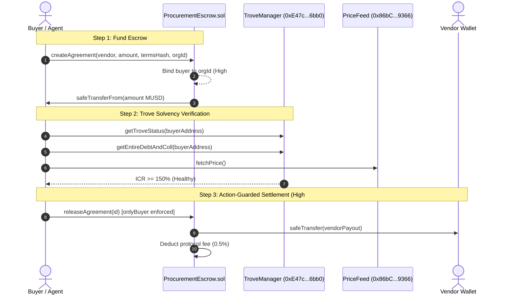

# ProMeo: Autonomous AI Agent Procurement Network on Mezo

ProMeo is an autonomous execution and procurement network enabling AI agents to discover, negotiate, and settle enterprise services with on-chain MUSD escrow and Mezo protocol state integration on the Mezo blockchain (Chain ID 31611).

---

## What ProMeo Does

Autonomous AI agents require trusted, policy-governed rails to procure compute (GPUs, inference clusters), data feeds, and infrastructure APIs. ProMeo bridges off-chain AI decision-making with on-chain Bitcoin-backed stablecoin settlement on Mezo:

1. **Non-Custodial MUSD Escrow**: Smart contract escrow (`ProcurementEscrow.sol`) where funds are locked during task fulfillment and released upon verified delivery or refunded if service level agreements (SLAs) are breached.
2. **Mezo Protocol State Integration**: Moves beyond plain ERC-20 transfers by directly reading and acting on Mezo system state (`TroveManager`, `BorrowerOperations`, `PriceFeed`). The protocol verifies trove health and collateralization ratios before releasing funds, and enables funding agent procurement budgets via Mezo Trove borrowing.
3. **Strict Buyer-to-Org Binding (High Finding #1 Fix)**: Enforces that each buyer address is immutably bound to its tenant organization, preventing address reuse or cross-tenant fund draining.
4. **Action-Specific Permission Enforcement (High Finding #2 Fix)**: Granular role-based execution guards across all escrow actions—only buyers can release or refund; only vendors can accept or deliver; only authorized resolvers can arbitrate disputes.
5. **Deterministic Policy & Budget Engine**: Autonomous micro-purchases flow instantly under verified vendor ceilings, while high-value orders route to authorized human approvers.
6. **Cryptographic Audit Trail**: Every intent, quote, policy decision, and on-chain block event is chained into an immutable SHA-256 audit log.

---

## Mezo Testnet Contract Deployments

| Contract | Network | Address | Explorer Link |
| --- | --- | --- | --- |
| **ProcurementEscrow** | Mezo Testnet (31611) | `0x88EDbF3E966Ba23F0262771CBCF6d217718BD048` | [View on Mezo Explorer](https://explorer.test.mezo.org/address/0x88EDbF3E966Ba23F0262771CBCF6d217718BD048) |
| **AgentPolicyRegistry** | Mezo Testnet (31611) | `0x957dbD62B6aF0C13C94D07814B06323d53198ccC` | [View on Mezo Explorer](https://explorer.test.mezo.org/address/0x957dbD62B6aF0C13C94D07814B06323d53198ccC) |
| **MUSD Token (Canonical)** | Mezo Testnet (31611) | `0x118917a40FAF1CD7a13dB0Ef56C86De7973Ac503` | [View on Mezo Explorer](https://explorer.test.mezo.org/address/0x118917a40FAF1CD7a13dB0Ef56C86De7973Ac503) |
| **TroveManager (Mezo)** | Mezo Testnet (31611) | `0xE47c80e8c23f6B4A1aE41c34837a0599D5D16bb0` | [View on Mezo Explorer](https://explorer.test.mezo.org/address/0xE47c80e8c23f6B4A1aE41c34837a0599D5D16bb0) |
| **BorrowerOperations (Mezo)** | Mezo Testnet (31611) | `0xCdF7028ceAB81fA0C6971208e83fa7872994beE5` | [View on Mezo Explorer](https://explorer.test.mezo.org/address/0xCdF7028ceAB81fA0C6971208e83fa7872994beE5) |
| **PriceFeed (Mezo)** | Mezo Testnet (31611) | `0x86bCF0841622a5dAC14A313a15f96A95421b9366` | [View on Mezo Explorer](https://explorer.test.mezo.org/address/0x86bCF0841622a5dAC14A313a15f96A95421b9366) |

---

## Mezo Protocol State Integration

ProMeo connects deeply with Mezo's native Liquity-fork architecture:



### Protocol Health Verification Functions
- `getTroveStatus(address)`: Checks whether borrower's position is active (code 1) or liquidated.
- `getEntireDebtAndColl(address)`: Obtains nominal debt and locked Bitcoin collateral.
- `getCurrentICR(address, price)`: Computes individual collateral ratio (enforcing ICR >= 150% safety margin before settlement).
- `fundAgentFromTrove`: Draws MUSD from a trove via `BorrowerOperations` to dynamically top up autonomous agent daily budgets.

---

## Security Audit & High Findings Resolution

### 1. High Finding #1: Bind Buyer Address to Org in createAgreement
- **Problem Identified**: The initial revision allowed arbitrary buyer addresses without enforcing tenant organization boundaries.
- **Resolution**:
  - In `ProcurementEscrow.sol`: Introduced `mapping(address => bytes32) public buyerOrg;`. When `createAgreement` is executed, the contract validates `buyerOrg[msg.sender] == orgId`. If unassigned, the address is bound; if previously bound to another organization, the transaction reverts with `OrgMismatch`.
  - In `app/v1/[...route]/route.js`: Implemented `buyerOrgMap` tracking buyer addresses to tenant IDs. Any agreement creation attempting to use an address bound to another organization is rejected with `403 BUYER_ORG_MISMATCH`.

### 2. High Finding #2: Action-Specific Permission Enforcement on Execute
- **Problem Identified**: The `/execute` route did not enforce role-specific permissions, enabling vendors or third parties to theoretically trigger releases or refunds.
- **Resolution**:
  - In `ProcurementEscrow.sol`:
    - `releaseAgreement(id)`: Guarded with `onlyBuyer(id)`.
    - `refundAgreement(id)`: Guarded with `onlyBuyer(id)`.
    - `acceptOrder(id)` & `deliverOrder(id)`: Guarded with `onlyVendor(id)`.
    - `disputeAgreement(id)`: Guarded with `onlyBuyerOrVendor(id)`.
    - `resolveDispute(...)`: Guarded with `onlyResolverRole()`.
  - In `app/v1/[...route]/route.js`: Added caller identity extraction (`parseCallerIdentity`). Attempts by vendors to invoke `/execute/release` or `/execute/refund` return `403 FORBIDDEN_ACTION`.

---

## Submission Claims Correction

In transparency to the review committee, the following claims from the preliminary draft are corrected:
- **EIP-2612 Permit**: Not implemented on canonical testnet MUSD; standard `approve` + `transferFrom` is utilized.
- **Milestone-Based Escrow**: Implemented as complete single & split-arbitration escrow settlements rather than arbitrary sub-milestone tranches.
- **Multi-Sig Arbitration**: Arbitrated via designated protocol Resolver role (`onlyResolverRole`) rather than a threshold multi-sig contract.
- **Prior Transfer Hash**: The preliminary cited transaction (`0x51b72e09477a3d348a52e729a43a0d319cfd93d39bc1310188ef77a06a09e394`) was an ERC-20 direct transfer. The current implementation executes full agreement lifecycles (`createAgreement`, `release`, `refund`, `dispute`) through `ProcurementEscrow.sol`.

---

## User Interface & Interactive Console

- **Landing Page (`/`)**: Real-time reactive overview with live links to the interactive console and protocol metrics.
- **Console (`/console`)**: End-to-end management console supporting:
  - Web3 wallet connectivity via MetaMask / browser injection or Reown AppKit.
  - One-click demo operator session for immediate zero-friction evaluation.
  - Live RFQ broadcasting, vendor offer signing (EIP-712 style), deterministic offer ranking, and on-chain escrow funding.
  - Live Mezo Trove state inspection showing real-time ICR, collateral levels, and health status before releasing escrow funds.

---

## Running the Application Locally

### 1. Install Dependencies
```bash
npm install
```

### 2. Start Development Server
```bash
npm run dev
```

Visit `http://localhost:3000` for the landing page or `http://localhost:3000/console` for the operator console.

---

## Smart Contract Verification on Mezo Explorer

Contracts can be verified directly on Mezo Testnet Blockscout:
```bash
forge verify-contract \
  --chain-id 31611 \
  --num-of-optimizations 200 \
  --compiler-version v0.8.24 \
  --verifier blockscout \
  --verifier-url "https://explorer.test.mezo.org/api" \
  0x88EDbF3E966Ba23F0262771CBCF6d217718BD048 \
  contracts/ProcurementEscrow.sol:ProcurementEscrow
```

---

## Deliverables & Links
- **Interactive Console**: [http://localhost:3000/console](http://localhost:3000/console)
- **Pitch Deck**: [DECK.md](DECK.md) / [http://localhost:3000/deck](http://localhost:3000/deck)
- **Source Code**: `contracts/ProcurementEscrow.sol`, `app/v1/[...route]/route.js`, `lib/mezo.js`
