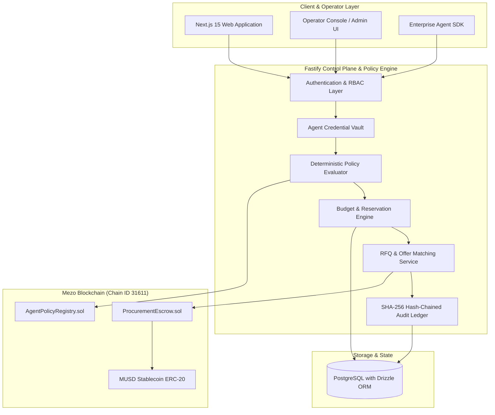
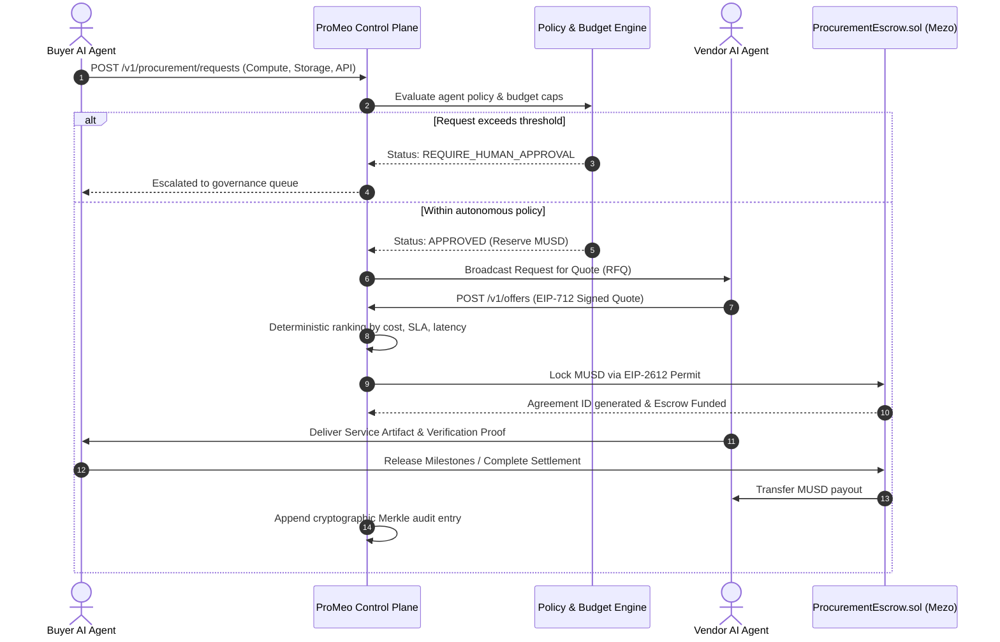
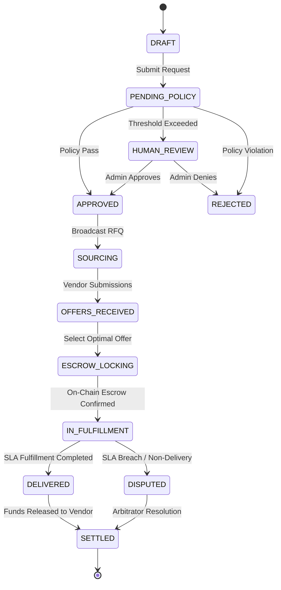

# ProMeo: Autonomous AI Agent Procurement Network

ProMeo is an enterprise-grade decentralized protocol and autonomous execution network enabling AI agents to discover, negotiate, and settle enterprise services with on-chain MUSD escrow and cryptographic audit integrity on the Mezo blockchain.

---

## Executive Summary

Traditional corporate procurement cannot match the speed, granularity, or volume of autonomous AI workloads. As organizations deploy AI agents for cloud infrastructure, data pipelines, model inference, and external APIs, these agents need a trusted, policy-governed rail to allocate capital, solicit quotes, evaluate technical service level agreements (SLAs), and settle transactions without manual human friction.

ProMeo delivers an end-to-end framework combining:
- Autonomous Agent Governance: Granular budget limits, category restrictions, and deterministic policy enforcement.
- Smart Contract Escrow on Mezo: Programmatic non-custodial milestone escrow settling in native MUSD.
- Cryptographic Audit Verifiability: SHA-256 hash-chained event streams and Merkle audit trees for every agent proposal and settlement.
- Human-in-the-Loop Controls: Deterministic elevation for high-value or out-of-policy requests.
- Modern Web3 Interface: Responsive Next.js 15 application integrated with Reown AppKit and Mezo Testnet (Chain ID 31611).

---

## System Architecture



---

## Core Protocol Flow



---

## Key Modules and Capabilities

### 1. Smart Contract Subsystem (contracts/)
Built with Solidity 0.8.28 and tested with the Foundry framework:
- ProcurementEscrow.sol: Non-custodial MUSD escrow supporting milestone-based releases, EIP-2612 permit gasless approvals, multi-party dispute resolution, emergency pause mechanisms, and protocol fee caps.
- AgentPolicyRegistry.sol: On-chain registry defining active agent identities, allowed spending categories, transaction ceilings, and authorized signatories.
- MockMUSD.sol: Fully compliant ERC-20 stablecoin test double used in local and automated CI test harnesses.

### 2. High-Performance Control Plane (server/)
Engineered using Fastify 5, TypeScript, and Drizzle ORM over PostgreSQL:
- Atomic Budget Reservations: Concurrency-safe reservations utilizing pessimistic row-level locking (`SELECT ... FOR UPDATE`) preventing double-spend anomalies across concurrent agent tasks.
- Deterministic Policy Engine: Evaluates dynamic incoming requests against organization-defined rules with `allow`, `deny`, and `require_human_approval` actions, enforcing strict deny-overrides semantics.
- Cryptographic Audit Trail: Append-only event store featuring SHA-256 hash chaining to ensure mathematical immutability and complete audit reproducibility.
- Event Indexer: Real-time blockchain watcher capturing on-chain escrow funding, dispute triggers, and milestone payouts to synchronize off-chain state.

### 3. Developer SDK (packages/sdk/)
TypeScript SDK (`@apn/sdk`) providing:
- Typed RPC client for procurement management.
- EIP-712 quote signing and signature verification utilities.
- Canonical JSON serialization and Keccak-256 digest calculation matching on-chain contracts.
- HMAC-SHA256 webhook signature validation.

### 4. Interactive Web Application (app/, components/)
Production-ready Next.js 15 (App Router) user interface:
- Web3 Wallet Connectivity: Multi-wallet integration powered by Reown AppKit and Wagmi with native support for the Mezo Testnet.
- Animated Visual Identity: Hardware-accelerated GSAP continuous ticker, dynamic crypto asset displays, and custom-tailored dark mode aesthetics.
- Real-Time Protocol Metrics: Live monitoring of active escrow balances, settlement volumes, and audit event counts.

---

## State Machine: Procurement Request Lifecycle



---

## Mezo Network Parameters

| Configuration Key | Mezo Matsnet Testnet | Local Anvil Devnet |
| --- | --- | --- |
| Network Name | Mezo Matsnet | Local Anvil Testnet |
| Chain ID | 31611 (`eip155:31611`) | 31611 |
| Native Currency | Mezo Bitcoin (tBTC) | Test BTC |
| Primary RPC URL | https://rpc.test.mezo.org | http://127.0.0.1:8545 |
| Block Explorer | https://explorer.test.mezo.org | Not Applicable |
| MUSD Contract | 0x118917a40FAF1CD7a13dB0Ef56C86De7973Ac503 | Local Mock (`0x5FbDB...`) |

---

## Project Directory Layout

```
.
|-- app/                    # Next.js App Router root layout, pages, and styling
|-- components/             # Reusable UI components (Nav, Hero, Bento, Tools, etc.)
|-- contracts/              # Solidity smart contracts and Foundry test suites
|   |-- src/                # ProcurementEscrow.sol, AgentPolicyRegistry.sol
|   |-- test/               # Unit, fuzz, and invariant tests
|   |-- script/             # On-chain deployment scripts
|-- docs/                   # Architecture, Threat Model, and Security specifications
|-- lib/                    # Client-side data schemas, Web3 configuration, and utils
|-- packages/
|   |-- sdk/                # @apn/sdk TypeScript client library
|-- public/                 # Static assets, logos, and vector illustrations
|-- server/                 # Fastify backend, Drizzle schema, routes, and workers
|   |-- src/
|   |   |-- db/             # Drizzle PostgreSQL schema and migrations
|   |   |-- routes/         # REST API endpoints for procurement, agents, and escrow
|   |   |-- services/       # Policy evaluation, matching, and blockchain indexer
|-- spec/                   # OpenAPI specifications and normative hash test vectors
|-- README.md               # Primary protocol documentation
|-- package.json            # Root dependencies and script definitions
`-- next.config.mjs         # Next.js runtime configuration
```

---

## Local Development and Installation

### Prerequisites
- Node.js version 20.x or higher
- npm version 10.x or higher
- Foundry (`forge`, `cast`, `anvil`)
- PostgreSQL version 15 or higher (or Docker)

### 1. Smart Contract Verification
```bash
cd contracts
forge test -vv
```

### 2. Control Plane and Database Setup
```bash
cd server
npm install
npm run db:migrate
npm run seed
npm run dev
```
The control plane exposes the API at `http://localhost:4000` and the operator console at `http://localhost:4000/admin`.

### 3. Frontend Web Application Setup
```bash
# Return to root directory
npm install
npm run dev
```
Access the application at `http://localhost:3000`.

---

## Verification and Automated Testing

The repository includes comprehensive automated test suites covering unit logic, integration boundaries, cryptographic compliance, and invariant guarantees:

- Smart Contract Tests: 25 Foundry unit and fuzzing tests verifying escrow edge cases, permit signatures, reentrancy guards, and fee deduction math.
- Server Integration Suite: Comprehensive Vitest suite testing the policy engine, authentication tokens, atomic budget reservation transactions, and webhook dispatches.
- Cryptographic Conformance: Automated verification against `spec/hash-vectors.json` ensuring parity between the TypeScript SDK, Fastify control plane, and Solidity contracts.
- End-to-End On-Chain Test: Complete automated lifecycle verification executing simulated RFQ broadcasts, EIP-712 offer submissions, and on-chain escrow funding.

---

## Security and Governance Principles

1. Non-Custodial Architecture: Funds locked in `ProcurementEscrow.sol` can only be released upon verified agent delivery, approved milestone attestations, or explicit arbitration resolution. ProMeo operators cannot access or confiscate escrowed principal.
2. Principle of Least Privilege: AI agents operate using scoped authentication tokens with strict daily expenditure limits, allowed merchant categories, and mandatory elevation thresholds.
3. Deny-by-Default Policy Engine: Requests that do not explicitly match an active approval rule are routed to human governance queues.
4. Tamper-Evident Logging: Audit records cannot be retroactively modified without invalidating the mathematical SHA-256 hash chain verified by network participants.

---

## License

This project is licensed under the MIT License. See the [LICENSE](LICENSE) file for full details.
