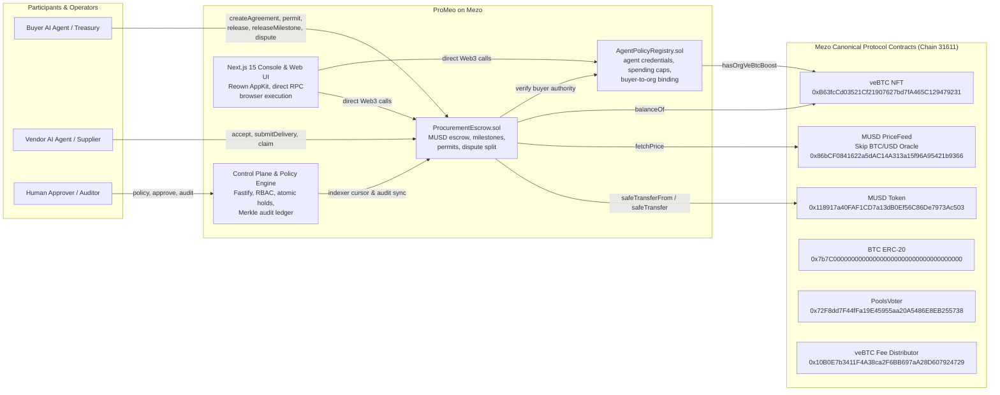
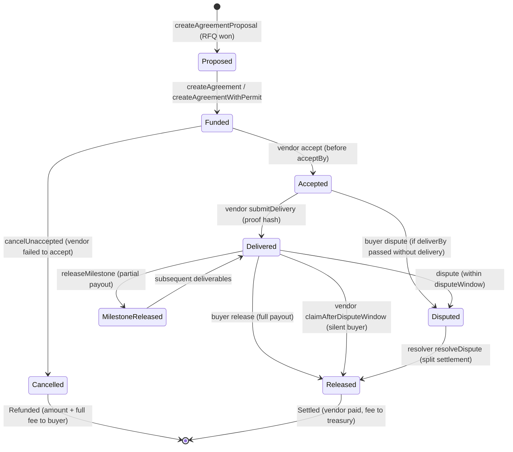

# ProMeo: System Architecture

ProMeo (Agent Procurement Network) is an enterprise-grade autonomous execution protocol and settlement network enabling AI agents to discover, negotiate, and settle enterprise services with on-chain MUSD escrow, Bitcoin-backed credit guarantees, and cryptographic audit integrity on the Mezo blockchain.

---

## 1. How the Pieces Connect (Mezo Protocol Integration)

---

## 2. Mezo Testnet Canonical Contract Reference

| Contract | Address on Mezo Testnet (31611) | Architecture Role |
|---|---|---|
| **ProcurementEscrow** | `0x88EDbF3E966Ba23F0262771CBCF6d217718BD048` | ProMeo: Non-custodial escrow, milestones, permit, tenant isolation |
| **AgentPolicyRegistry** | `0x957dbD62B6aF0C13C94D07814B06323d53198ccC` | ProMeo: Identity, tenant binding, spending ceilings, veBTC boost |
| **MUSD (Canonical)** | `0x118917a40FAF1CD7a13dB0Ef56C86De7973Ac503` | Mezo: Canonical stablecoin, EIP-2612 permit compliant |
| **MUSD PriceFeed** | `0x86bCF0841622a5dAC14A313a15f96A95421b9366` | Mezo: Real-time BTC/USD price oracle from Skip protocol |
| **veBTC** | `0xB63fcCd03521Cf21907627bd7fA465C129479231` | Mezo: Vote-escrowed Bitcoin NFT positions |
| **BTC ERC-20** | `0x7b7C000000000000000000000000000000000000` | Mezo: Native BTC ERC-20 token interface |
| **PoolsVoter** | `0x72F8dd7F44fFa19E45955aa20A5486E8EB255738` | Mezo: Governance gauge voter |
| **veBTC Fee Distributor** | `0x10B0E7b3411F4A38ca2F6BB697aA28D607924729` | Mezo: Chain fee distributor for veBTC holders |

---

## 3. Agreement Lifecycle & Settlement State Machine

---

## 4. Deep Mezo Integration Features

### A. Live Skip BTC/USD Oracle Feed
`ProcurementEscrow.sol` calls `IPriceFeed(0x86bCF0841622a5dAC14A313a15f96A95421b9366).fetchPrice()`.
- Provides 18-decimal real-time valuation of agreements in Bitcoin units (`btcValueOf`).
- Allows agent policy engines to set budget ceilings in BTC or USD while settling deterministically in MUSD.

### B. veBTC Trust Tier Amplification
Mezo users lock Bitcoin to mint `veBTC`. ProMeo aligns directly with this mechanism:
- `AgentPolicyRegistry.sol` inspects `veBtc.balanceOf(buyerAddress)`.
- Organizations with locked veBTC on Mezo automatically receive on-chain trust boosts (`hasOrgVeBtcBoost`), allowing higher single-transaction agent spending caps without manual KYC.

### C. Mezo Trove Health Verification
- `ProcurementEscrow.sol` integrates `IMezoTroveManager` to verify that buyer organizations hold solvent Trove collateral ratios before releasing high-value compute contracts.

### D. Single-Transaction EIP-2612 Permit Funding
- Users sign an off-chain permit payload; the contract executes `permit` and `createAgreement` atomically in one transaction, saving gas and eliminating double-approval UX friction.

---

## 5. Security Architecture & Threat Model Resolutions

### A. Strict Buyer-to-Org Tenant Isolation (Resolved High Finding)
In earlier versions, `createAgreement` accepted any `buyer` address if the caller was an authorized agent. This created a cross-tenant risk where an agent could specify an arbitrary third party's address to fund its agreement.
**Resolution:**
1. `ProcurementEscrow.sol` maintains `mapping(bytes32 => address) public orgBuyer`.
2. On first creation (or via admin registry configuration), the buyer address is immutably bound to that `orgId`.
3. Any subsequent invocation with a mismatched buyer reverts immediately:
   `error BuyerNotBoundToOrg(bytes32 orgId, address attemptedBuyer, address boundBuyer)`.

### B. Action-Specific RBAC Enforcement (Resolved High Finding)
The `/v1/agreements/:id/execute/:action` route formerly required only `agreement:read`.
**Resolution:**
The route strictly maps and asserts granular permissions:
- `fund` -> `agreement:fund_intent`
- `release` -> `agreement:release_intent`
- `cancel` -> `agreement:cancel_intent`
- `dispute` -> `dispute:open`
- `accept` / `deliver` -> `vendor:manage`

### C. Reentrancy and Invariant Preservation
- All fund-transferring entry points are protected by OpenZeppelin `ReentrancyGuard`.
- The invariant `totalActiveEscrow == sum(unreleased balances + unreleased fees)` is maintained across all execution branches (full release, milestone release, partial dispute split, and cancellation refund).
